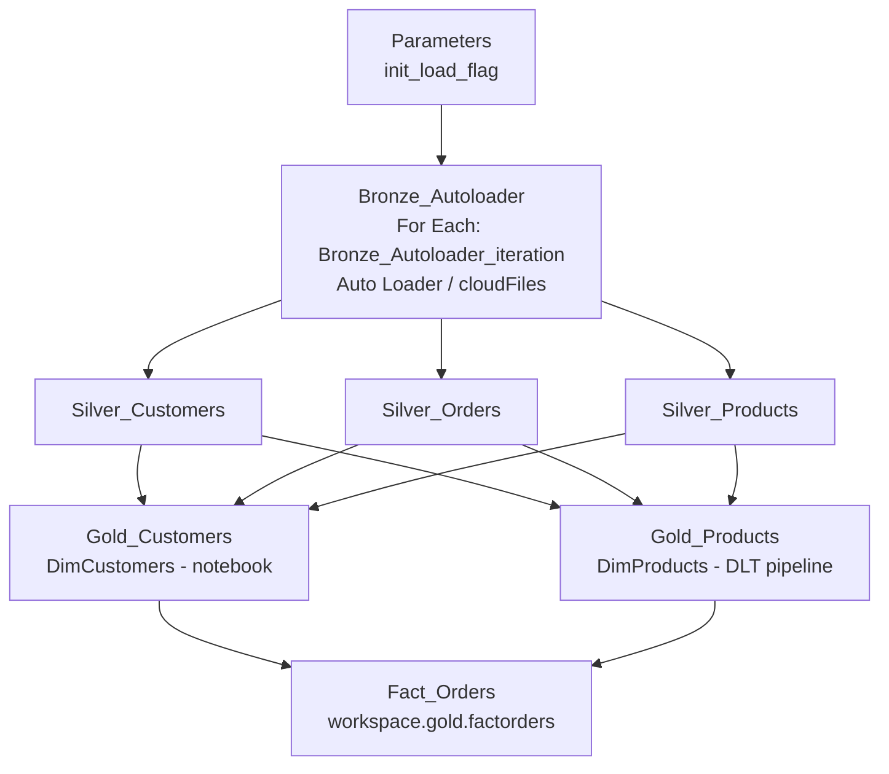
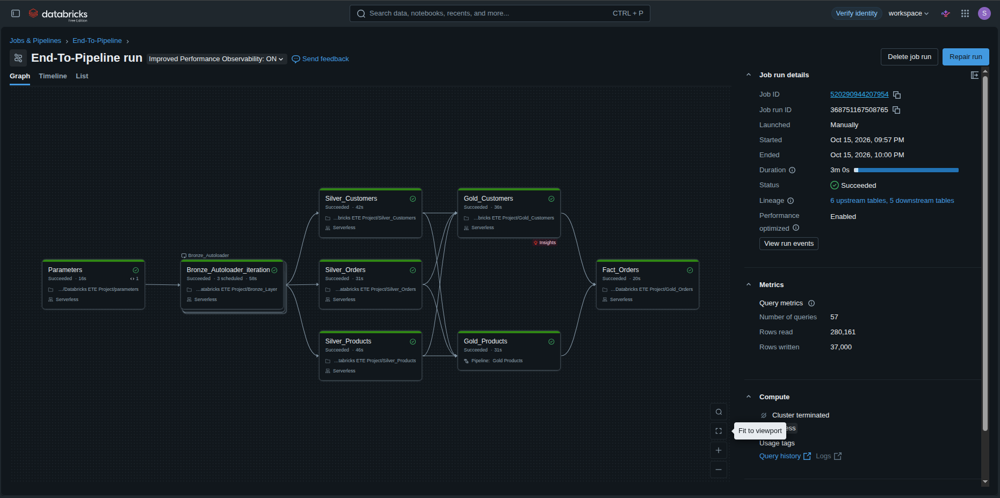
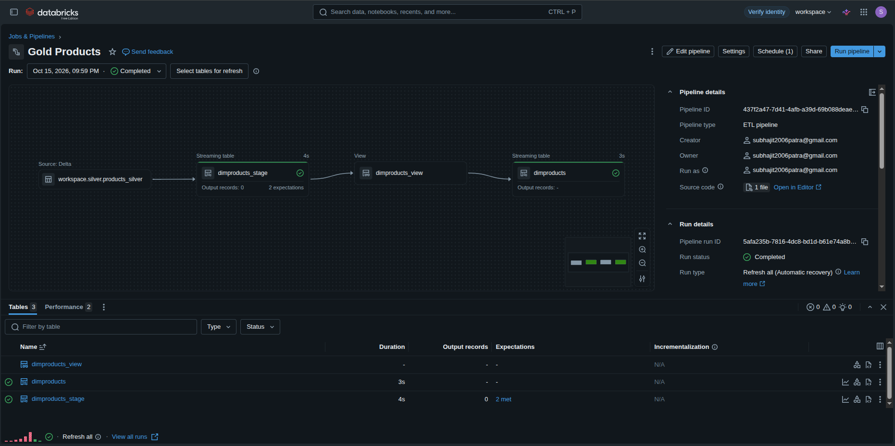
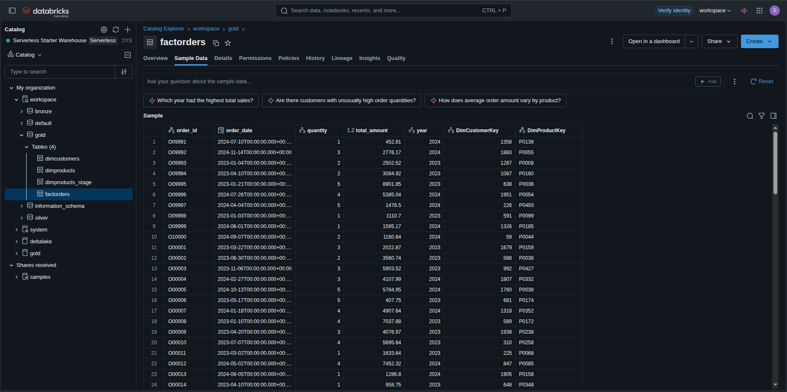

# Enterprise Medallion Lakehouse on Databricks


An end-to-end data engineering project that implements the **Medallion Architecture (Bronze → Silver → Gold)** on Databricks. Raw files are ingested with **Auto Loader**, cleaned in parallel **Silver** tasks, modeled into a **Star Schema** in the **Gold** layer (one dimension via notebook, one via **Delta Live Tables**), and finished with a surrogate-key-based **fact table**. The whole flow is orchestrated by a **Databricks Workflows (Jobs) DAG** on **Serverless compute** and completes end-to-end in about **3 minutes**.

---

## Key Highlights

| Area | Highlight |
|---|---|
| **Architecture** | Medallion Architecture (Bronze → Silver → Gold) on **Databricks Serverless** with Delta Lake tables |
| **Orchestration** | 8-task **Jobs DAG** (Databricks Workflows) with parallel Silver and Gold stages; full run in **~3 minutes** |
| **Ingestion** | **Auto Loader (`cloudFiles`)** with schema inference and evolution |
| **Streaming / quality** | **Delta Live Tables (DLT)** pipeline with `@dlt.expect_all_or_drop` expectations; `DimProducts` verified at **500 records** |
| **Modeling** | **Star Schema** with surrogate keys (`DimCustomerKey`, `DimProductKey`) feeding `FactOrders` |
| **Production debugging** | Fixed a Py4J widget parameter failure, a DLT streaming commit conflict (`skipChangeCommits`), and an unresolved-column defect |
| **Run modes** | `init_load_flag` job parameter toggles full vs. incremental loads without code changes |

---

## Table of Contents

1. [Key Highlights](#key-highlights)
2. [Executive Overview & Business Value](#executive-overview--business-value)
3. [Architecture](#architecture)
4. [Tech Stack](#tech-stack)
5. [Repository Layout](#repository-layout)
6. [Layer-by-Layer Implementation](#layer-by-layer-implementation)
7. [Jobs DAG & Orchestration](#jobs-dag--orchestration)
8. [Production Debugging & Lessons Learned](#production-debugging--lessons-learned)
9. [Setup & Deployment](#setup--deployment)
10. [Validation](#validation)
11. [Screenshots](#screenshots)
12. [Future Improvements](#future-improvements)

---

## Executive Overview & Business Value

Analytics teams need trustworthy, query-ready data, but raw operational files are messy, evolve over time, and arrive in inconsistent shapes. This project turns raw customer, order, and product data into a governed, analytics-ready star schema.

| Business need | How this project addresses it |
|---|---|
| Ingest new files without manual work | Auto Loader (`cloudFiles`) picks up new files incrementally, with schema inference and evolution |
| Trustworthy data | Layered cleaning (dedup, null handling, anomaly filtering) plus DLT quality expectations that drop bad rows |
| Fast, simple analytics | Star schema (`DimCustomers`, `DimProducts`, `FactOrders`) built on surrogate keys |
| Full reload vs. incremental runs | A single job-level parameter, `init_load_flag`, switches modes with no code changes |
| Reliable operations | A Jobs DAG with explicit dependencies and parallel Silver tasks; failures are isolated and diagnosable |

---

## Architecture

### ASCII flow

```
                    ┌────────────────────┐
                    │  Parameters        │
                    │  init_load_flag    │
                    └─────────┬──────────┘
                              ▼
┌────────────┐     ┌──────────────────────────────┐
│ Raw source │ ──► │ BRONZE  (For Each task:      │
│ files      │     │ Bronze_Autoloader)           │
└────────────┘     │ Bronze_Autoloader_iteration  │
                   │ Auto Loader (cloudFiles)     │
                   └──────────────┬───────────────┘
                                  │
         ┌────────────────────────┼────────────────────────┐
         ▼                        ▼                        ▼
┌─────────────────┐     ┌─────────────────┐     ┌─────────────────┐
│ SILVER          │     │ SILVER          │     │ SILVER          │
│ Silver_Customers│     │ Silver_Orders   │     │ Silver_Products │
│ dedup, std. ts  │     │ validate, filter│     │ nulls, price    │
│                 │     │ partition       │     │ normalization   │
└────────┬────────┘     └────────┬────────┘     └────────┬────────┘
         │   (every Silver task feeds both Gold tasks)   │
         └───────────────┬───────┴───────────────────────┘
                 ┌───────┴────────────────┐
                 ▼                        ▼
      ┌─────────────────┐     ┌─────────────────────┐
      │ GOLD            │     │ GOLD (DLT Pipeline) │
      │ Gold_Customers  │     │ Gold_Products       │
      │ DimCustomers    │     │ DimProducts_stage → │
      │ DimCustomerKey  │     │ DimProducts (upsert)│
      └────────┬────────┘     └──────────┬──────────┘
               └───────────┬─────────────┘
                           ▼
                ┌──────────────────────────┐
                │ FACT_ORDERS              │
                │ workspace.gold.factorders│
                │ DimCustomerKey +         │
                │ DimProductKey + measures │
                └──────────────────────────┘
```

### Mermaid diagram



### Star schema

```
            ┌──────────────────┐
            │  DimCustomers    │
            │  DimCustomerKey  │ (PK, surrogate)
            └────────▲─────────┘
                     │
            ┌────────┴─────────┐
            │   FactOrders     │
            │  DimCustomerKey  │ (FK)
            │  DimProductKey   │ (FK)
            │  quantity        │
            │  total_amount    │
            │  year            │
            └────────┬─────────┘
                     │
            ┌────────▼─────────┐
            │   DimProducts    │
            │   DimProductKey  │ (PK, surrogate)
            └──────────────────┘
```

---

## Tech Stack

| Category | Technology |
|---|---|
| Platform | Databricks (Serverless compute, Unity Catalog / workspace schemas) |
| Languages | PySpark, Spark SQL, Python |
| Ingestion | Databricks Auto Loader (`cloudFiles`) |
| Storage / Table format | Delta Lake |
| Declarative pipelines | Delta Live Tables (DLT) |
| Orchestration | Databricks Workflows (Jobs DAG) |
| Serving / validation | Serverless SQL Warehouse, Catalog Explorer |

---

## Repository Layout

> Folder names mirror the notebook paths in the Jobs UI (`Databricks ETE Project/...`). Adjust to match your repo.

```
.
├── README.md
├── Databricks ETE Project/
│   ├── parameters
│   ├── Bronze_Layer                # Bronze_Autoloader_iteration
│   ├── Silver_Customers
│   ├── Silver_Orders
│   ├── Silver_Products
│   ├── Silver_Regions
│   ├── Gold_Customers
│   ├── Gold_Products               # DLT pipeline source ("Gold Products")
│   └── Gold_Orders                 # Fact_Orders task
├── jobs/
│   └── medallion_job.json          # exported Jobs DAG definition
└── docs/
    └── screenshots/
        ├── job_run_dag.png
        ├── dlt_pipeline.png
        └── catalog_validation.png
```

---

## Layer-by-Layer Implementation

> Snippets below are representative of the pattern used in each layer. Replace paths and column names with those in your notebooks.

### 0. Parameters

A job-level parameter, `init_load_flag`, controls full vs. incremental processing. Downstream notebooks read it through Databricks widgets.

```python
dbutils.widgets.text("init_load_flag", "0")
init_load_flag = int(dbutils.widgets.get("init_load_flag"))
```

### 1. Bronze: Auto Loader ingestion

The ingestion notebook runs as `Bronze_Autoloader_iteration`, the inner task of a **For Each** task named `Bronze_Autoloader`. The source name is passed in as `p_file_name`, so one notebook ingests every source dataset (customers, orders, products, and so on).

Raw parquet files land in a Unity Catalog **Volume** (`/Volumes/workspace/default/source/<p_file_name>`). Auto Loader (`cloudFiles`) reads them incrementally, and the Bronze output is written to a second Volume path.

```python
# Dynamic Auto Loader reading configuration
df = (spark.readStream
      .format("cloudFiles")
      .option("cloudFiles.format", "parquet")
      .option("cloudFiles.schemaLocation", f"/Volumes/workspace/default/bronze/checkpoint_{p_file_name}")
      .load(f"/Volumes/workspace/default/source/{p_file_name}"))

# Dynamic Auto Loader writing configuration
(df.writeStream.format("parquet")
   .outputMode("append")
   .option("checkpointLocation", f"/Volumes/workspace/default/bronze/checkpoint_{p_file_name}")
   .option("path", f"/Volumes/workspace/default/bronze/{p_file_name}")
   .start())
```

Key points:

- **Dynamic, parameterized paths:** the `p_file_name` parameter drives the source path, the checkpoint, and the output path, so adding a new source needs no code change.
- **Schema tracking:** `cloudFiles.schemaLocation` stores the inferred schema so Auto Loader can track it across runs.
- **Exactly-once progress:** the streaming checkpoint records which files were processed, so reruns only pick up new files.
- **Storage format:** Bronze is stored as parquet files in a Volume; the Silver and Gold layers are Delta tables.

### 2. Silver: parallel cleaning & enrichment

Three notebooks run **in parallel** because they have no dependencies on each other.

| Task | Responsibilities |
|---|---|
| `Silver_Customers` | Deduplicate customer records, standardize timestamps |
| `Silver_Orders` | Validate order states, filter anomalous records, partition the data |
| `Silver_Products` | Clean the catalog, handle nulls, normalize prices → `workspace.silver.products_silver` |

```python
from pyspark.sql.functions import col, split, concat, lit

# Extract domain from email
df = df.withColumn("domains", split(col("email"), "@")[1])

# Construct full_name and drop redundant raw name columns
df = (df.withColumn("full_name", concat(col("first_name"), lit(" "), col("last_name")))
        .drop("first_name", "last_name"))
```

### 3. Gold: dimensional modeling

#### `Gold_Customers` (notebook task)

Builds `DimCustomers`, generates the surrogate key `DimCustomerKey`, and reads `init_load_flag` via widgets to switch between full and incremental loads.

```python
dbutils.widgets.text("init_load_flag", "0")
init_load_flag = int(dbutils.widgets.get("init_load_flag"))

# surrogate key + business attributes
dim_customers = (
    spark.table("workspace.silver.customers_silver")
         .withColumn("DimCustomerKey", F.monotonically_increasing_id() + 1)
)
```

#### `Gold_Products` (Delta Live Tables pipeline task)

A DLT streaming pipeline stages data from Silver, applies quality expectations, and upserts into the `DimProducts` target.

```python
import dlt

rules = {"valid_product_name": "product_name IS NOT NULL"}

@dlt.table(name="DimProducts_stage")
@dlt.expect_all_or_drop(rules)
def dimproducts_stage():
    return (
        spark.readStream
             .option("skipChangeCommits", "true")
             .table("workspace.silver.products_silver")
    )

@dlt.view
def dimproducts_view():
    return dlt.read_stream("DimProducts_stage")

dlt.create_streaming_table("DimProducts")

dlt.apply_changes(
    target="DimProducts",
    source="dimproducts_view",
    keys=["product_id"],
    sequence_by="<ordering_column>",
    stored_as_scd_type=1,
)
```

Result: `DimProducts` verified at **500 records**.

### 4. Fact table: `Fact_Orders`

Joins the Silver orders (`df`) to the Gold dimensions to replace natural keys with surrogate keys, then overwrites `workspace.gold.factorders`. The dimension queries alias the natural keys (`dim_customer_id`, `dim_product_id`) so the join columns never collide with the fact columns.

```python
# Select surrogate keys and alias natural keys from Gold dimensions
df_dimcus = spark.sql("SELECT DimCustomerKey, customer_id AS dim_customer_id FROM workspace.gold.dimcustomers")
df_dimpro = spark.sql("SELECT product_id AS DimProductKey, product_id AS dim_product_id FROM workspace.gold.dimproducts")

# Left join dimensions to Fact and drop duplicate natural keys
df_fact = (df.join(df_dimcus, df["customer_id"] == df_dimcus["dim_customer_id"], how="left")
             .join(df_dimpro, df["product_id"] == df_dimpro["dim_product_id"], how="left"))

df_fact_new = df_fact.drop("dim_customer_id", "dim_product_id", "customer_id", "product_id")

# Save final fact table
df_fact_new.write.mode("overwrite").saveAsTable("workspace.gold.factorders")
```

Key points:

- **Alias to avoid collisions:** natural keys from the dimensions are renamed so the left joins leave no ambiguous columns.
- **Left joins:** every order row is kept even if a dimension match is missing, so orphan keys can be audited with the validation queries below.
- **Clean output:** natural keys are dropped, leaving the surrogate foreign keys (`DimCustomerKey`, `DimProductKey`) plus the order measures.

---

## Jobs DAG & Orchestration

```
Parameters
   └─► Bronze_Autoloader [For Each] ─► Bronze_Autoloader_iteration
          ├─► Silver_Customers ─┬─► Gold_Customers (notebook) ─┐
          ├─► Silver_Orders ────┤                              ├─► Fact_Orders
          └─► Silver_Products ──┴─► Gold_Products (DLT) ───────┘
```

Each Silver task feeds **both** Gold tasks, and `Fact_Orders` waits on both Gold tasks.

| Task | Type | Depends on | Purpose |
|---|---|---|---|
| `Parameters` | Notebook | none | Initialize `init_load_flag` |
| `Bronze_Autoloader_iteration` | Notebook inside a For Each task (`Bronze_Autoloader`) | Parameters | Auto Loader ingestion |
| `Silver_Customers` | Notebook | Bronze | Dedup, timestamp standardization |
| `Silver_Orders` | Notebook | Bronze | Validation, anomaly filtering, partitioning |
| `Silver_Products` | Notebook | Bronze | Null handling, price normalization |
| `Gold_Customers` | Notebook | All 3 Silver tasks | `DimCustomers` + `DimCustomerKey` |
| `Gold_Products` | DLT pipeline | All 3 Silver tasks | `DimProducts` with quality expectations |
| `Fact_Orders` | Notebook | Gold_Customers, Gold_Products | Star-schema fact table |

- **Compute:** Serverless
- **Runtime:** Full run completes in about **3m 0s**
- **Parallelism:** Silver tasks run in parallel, then both Gold tasks run in parallel, reducing wall-clock time versus a linear chain

---

## Production Debugging & Lessons Learned

### 1. `Py4JJavaError` on widget parameter

| | |
|---|---|
| **Symptom** | `Gold_Customers` failed with `Py4JJavaError` when reading `init_load_flag` |
| **Root cause** | The parameter was defined in the notebook but not passed from the Job's task configuration, so the widget had no value in the job context |
| **Fix** | Added `init_load_flag` as a dynamic task/job parameter in Databricks Workflows |
| **Lesson** | Any `dbutils.widgets.get()` call must have a matching parameter in the job definition. Define a default in the notebook for safe interactive runs. |

### 2. `[UNRESOLVED_COLUMN.WITH_SUGGESTION]`

| | |
|---|---|
| **Symptom** | `Gold_Customers` failed with an unresolved column error |
| **Root cause** | A typo: `DimCustomersKey` was referenced where the column is `DimCustomerKey` |
| **Fix** | Read the "did you mean" suggestion in the error, then corrected and refactored the column reference |
| **Lesson** | Centralize key column names as constants and share them across notebooks to prevent drift |

### 3. DLT streaming failure: `DELTA_SOURCE_TABLE_IGNORE_CHANGES`

| | |
|---|---|
| **Symptom** | `Gold_Products` DLT pipeline failed with `STREAM_FAILED` |
| **Root cause** | The upstream `workspace.silver.products_silver` table was rewritten via `CREATE OR REPLACE` / overwrite. A streaming reader treats updates and deletes in a source as unsupported by default. |
| **Diagnosis** | Inspected the DLT **event log**, which surfaced the `DELTA_SOURCE_TABLE_IGNORE_CHANGES` error |
| **Fix** | Set `.option("skipChangeCommits", "true")` on `spark.readStream` and ran a clean **full refresh** to reset the checkpoint |
| **Lesson** | When a streaming table reads from a table that is periodically overwritten, either use `skipChangeCommits` (and accept that rewritten data is not re-emitted) or read it as a batch/materialized view. Always check the DLT event log first. |

---

## Setup & Deployment

### Prerequisites

- A Databricks workspace with Serverless compute enabled
- Permission to create schemas (`bronze`, `silver`, `gold`) in the `workspace` catalog
- Unity Catalog Volumes under `workspace.default`: `source` (raw parquet files, one folder per dataset) and `bronze` (Auto Loader output and checkpoints)

### Steps

1. **Clone the repo**
   ```bash
   git clone https://github.com/<your-username>/<repo-name>.git
   ```
2. **Import into Databricks.** Use **Workspace → Repos / Git folders → Add Repo**, or import the `notebooks/` folder manually.
3. **Create schemas**
   ```sql
   CREATE SCHEMA IF NOT EXISTS workspace.bronze;
   CREATE SCHEMA IF NOT EXISTS workspace.silver;
   CREATE SCHEMA IF NOT EXISTS workspace.gold;
   ```
4. **Create the DLT pipeline** for `Gold_Products`: **Jobs & Pipelines → Create → ETL pipeline**, point it at the DLT notebook, set the target catalog and schema to `workspace.gold`, and choose Serverless.
5. **Create the Job** with the tasks and dependencies from the [DAG table](#jobs-dag--orchestration), or import `jobs/medallion_job.json`.
6. **Add the job parameter** `init_load_flag` (for example `1` for the first full load, `0` for incremental runs).
7. **Run the job** and monitor it from the Runs tab.

### Run modes

| `init_load_flag` | Behavior |
|---|---|
| `1` | Initial / full load |
| `0` | Incremental load |

---

## Validation

Verified using Catalog Explorer and a Serverless SQL Warehouse.

```sql
SELECT COUNT(*) FROM workspace.gold.dimproducts;      -- 500 records
SELECT COUNT(*) FROM workspace.gold.factorders;

-- Referential integrity: facts with no matching dimension row
SELECT COUNT(*) AS orphan_customers
FROM workspace.gold.factorders f
LEFT JOIN workspace.gold.dimcustomers c USING (DimCustomerKey)
WHERE c.DimCustomerKey IS NULL;

-- Sample analytics query
SELECT p.product_name, f.year, SUM(f.total_amount) AS revenue
FROM workspace.gold.factorders f
JOIN workspace.gold.dimproducts p USING (DimProductKey)
GROUP BY p.product_name, f.year
ORDER BY revenue DESC
LIMIT 10;
```

---

## Screenshots

### Jobs DAG run


### Delta Live Tables pipeline


### Catalog validation


---

## Future Improvements

- Add SCD Type 2 history tracking for `DimCustomers`
- Move quality checks for Silver into DLT expectations for consistent observability
- Add CI/CD with Databricks Asset Bundles for environment promotion
- Add alerting on job failures and data-quality metrics
- Add unit tests for transformation logic with `pytest` and a local Spark session

---

## Author

**Subhajit Patra** · [LinkedIn](https://www.linkedin.com/in/subhajit-patra-b21a3028b) · [GitHub](https://github.com/Subhajit-2023-44)
